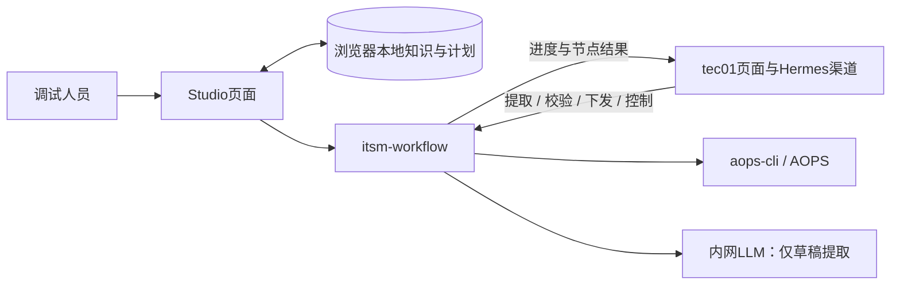
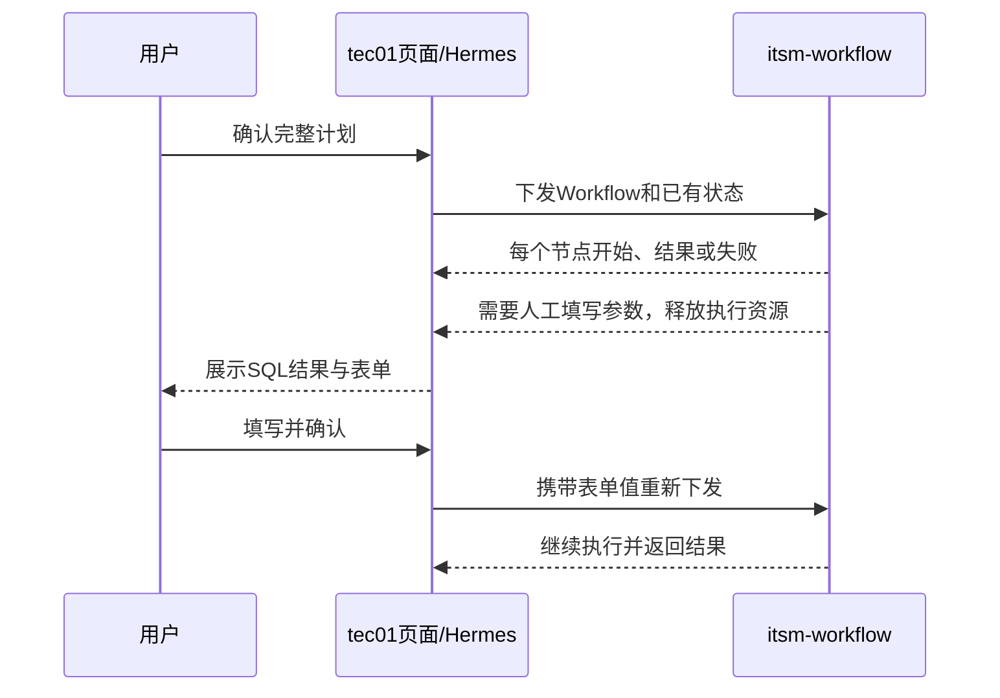

# 当前实现架构

计划驻留内存，运行回调获得tec01保存及采纳确认后连续推进；当前使用HTTP200、整数status=200及匹配data.runId的AopsResult，不再要求saved。具体实现与tec01配套事项见[当前交付说明](tec01-extraction-execution-alignment.md)。旧泳道图仅作交互概览，以方向API文档的当前契约为准。

独立流程图：[草稿提取](extraction-flow.md)、[Workflow执行](execution-flow.md)。两份文档分别说明生产对接、人工交互、异常处理及独立Studio调试的区别。

## 两端职责

| 位置 | 负责内容 | 存储 |
|---|---|---|
| tec01 | 生产知识、版本、计划、运行状态、结果、权限、MCP、Hermes消息渠道 | tec01数据库 |
| itsm-workflow | 节点定义、JSON Schema、工单草稿提取、校验和Workflow执行 | 活动任务内存与有限期事件缓存 |
| Studio浏览器 | 调试知识、手工定义、执行计划、节点结果 | IndexedDB；支持JSON导入导出 |

后台不建立SQLite、PostgreSQL或其他业务数据库。生产恢复依赖tec01重新下发状态；独立调试依赖浏览器保存的快照。API Key只存在于当前请求和执行内存。

## 执行侧模块

| 模块 | 主要代码 | 职责 |
|---|---|---|
| Node Registry | `app/runtime/registry.py`、`builtin_nodes.py` | 配置、输入输出Schema、版本和节点目录 |
| Compiler | `app/extraction.py`、`compiler_service.py` | 过滤成功只读操作、参数化、中文提炼、生成草稿、阶段回报 |
| Planner | `app/runtime/planner.py` | DAG归一化、只读SQL和绑定校验、内容哈希、调试计划 |
| Node Executor | `app/runtime/executor.py` | 执行SQL读、条件判断、人工表单和结束节点 |
| Push Executor | `app/runtime/push_executor.py` | 异步下发、恢复、并发限制、暂停/取消、逐节点回调 |
| CLI Adapter | `app/cli.py` | 安全argv调用、SSE解析、进程组控制、诊断脱敏 |
| tec01 Client | `app/tec01_client.py` | 统一提取与运行回调、稳定幂等键和失败重试 |
| Studio | `frontend`、`app/studio` | 浏览器持久化、画布、调试交互、临时事件读取 |

## 运行与人的交互

等待用户时没有常驻执行任务。暂停/失败同样释放资源；取消停止当前执行。条件节点可用SQL的 `rowCount` 决定是否进入人工表单。

独立Studio通过最小或完整Workflow使用同一Executor，结果回到浏览器；勾选同步时再调用tec01的统一回调。后台事件缓存用于短期页面追踪，不能代替浏览器或tec01持久化。
