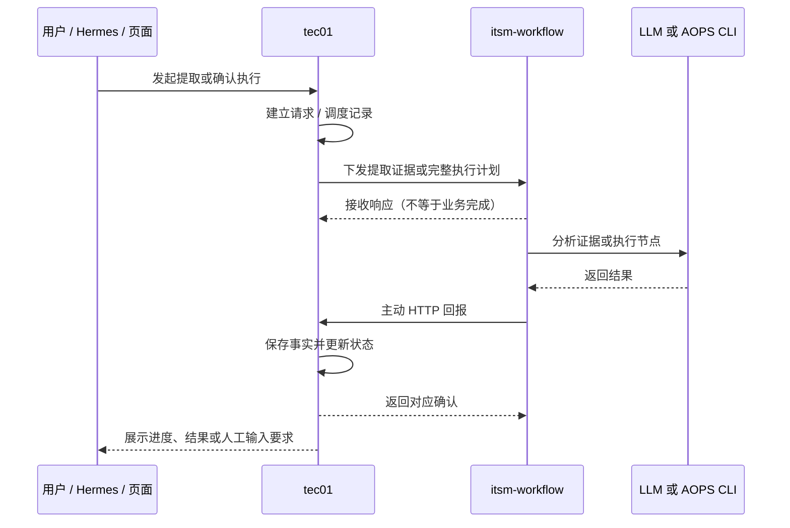
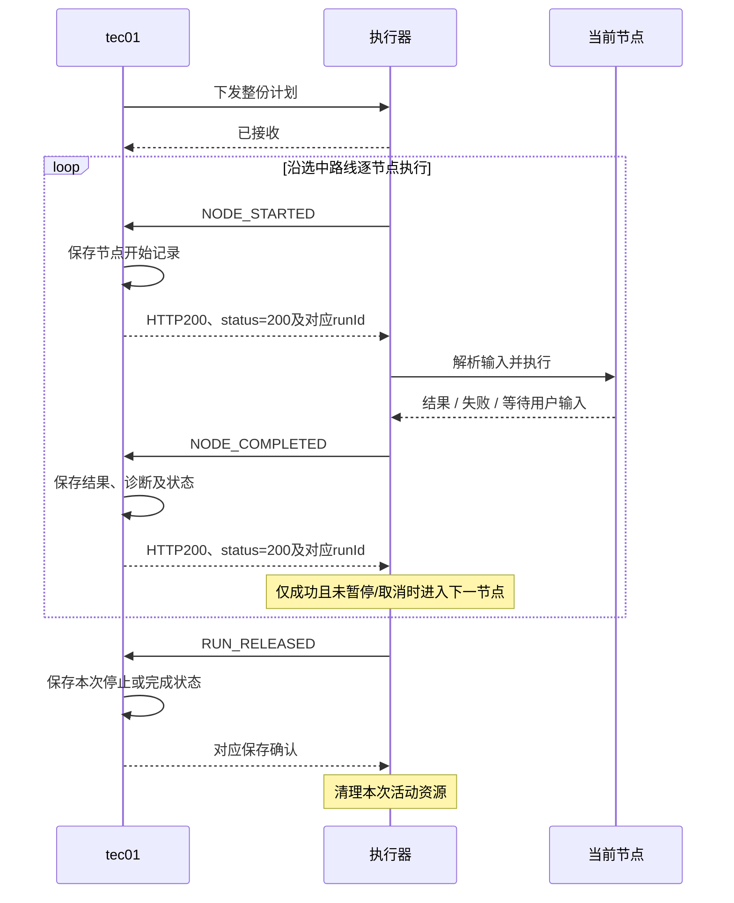

# 提取与执行全流程回报说明

适用实现：0.12.3，已对齐五阶段单次回报、AopsResult及TERMINATED；旧安装包需升级部署才生效。本文说明当前代码实际行为，供运维、tec01、页面与 Hermes 接入人员共同核对。tec01 开发对齐请使用[提取与执行对齐交付文档](tec01-extraction-execution-alignment.md)。协议字段详见[tec01 回报接口](tec01-to-itsm-workflow-api.md)，完整下发接口见[全流程 API 文档](workflow-full-api-guide-0.12.0.md)。

## 1. 阶段回报与“第 1/6 次尝试”的区别

这是两种不同的计数：**阶段进度**与**一条消息的 HTTP 发送尝试次数**。

| 页面中的操作说明 | 实际发送时机 | 正常情况下的发送尝试 |
|---|---|---|
| 过滤有效 SQL 操作 | 进入阶段时一条 | 第 1/6 次 |
| 去重并参数化 SQL | 进入阶段时一条，不再逐项回报 | 第 1/6 次 |
| 分析工单和操作记录 | 仅进入分析时一条，不发送定时心跳 | 第 1/6 次 |
| 生成 Workflow 草稿 | 进入该阶段一条 | 第 1/6 次 |
| 校验 Workflow | 进入该阶段一条 | 第 1/6 次 |

N是过滤后、去重前的操作数。progress=0/N只表示阶段开始，最终统计和过滤原因统一看diagnostics。分析期间没有定时回报，页面可显示已等待时长，不应把没有新消息直接判为失败。旧版过滤起止及参数化逐项回报已取消；原始HTTP开始/结束日志仍会成对出现。

“第 1/6 次”表示：**这条消息首次发送，上限为六次尝试；不是已经重试六次，也不是整个阶段第一次执行。**

正常提取成功时，不论SQL条数多少，均为以下六条业务回报：

| 示例 seq | type | stage / status | 消息含义 | 每条消息的尝试 |
|---:|---|---|---|---|
| 1 | PROGRESS | FILTERING_OPERATIONS | 开始过滤，0/原始操作数 | 1/6 |
| 2 | PROGRESS | PARAMETERIZING_SQL | 开始去重参数化 | 1/6 |
| 3 | PROGRESS | ANALYZING_EVIDENCE | 开始 LLM 分析 | 1/6 |
| 4 | PROGRESS | BUILDING_WORKFLOW | 开始组装结构化草稿 | 1/6 |
| 5 | PROGRESS | VALIDATING_WORKFLOW | 开始 Workflow 校验 | 1/6 |
| 6 | FINISHED | SUCCEEDED | 返回草稿、校验信息、过滤统计 | 1/6 |

上表序号仅用于说明：失败可能提前结束；新提取请求也不应假设 seq 必须从 1 开始。

### 如何辨别真正的重复与重试

| 标识 | 含义 | 判断方式 |
|---|---|---|
| knowledgeId | 经验标识 | 同一经验的所有提取回报相同 |
| requestId | 本次提取请求标识 | 同一次提取所有阶段相同，不代表同一条进度 |
| seq | 提取事件序号 | 同一次请求中不同阶段递增；重发同一事件不变 |
| X-Request-Id | 回报幂等键 | 同一业务消息重发保持不变 |
| callId | 一轮回报发送及其自动重试的关联号 | 同一轮自动重试相同，不同进度消息不同 |
| spanId | 一次 HTTP 尝试的关联号 | 将该次调用的开始、完成或失败日志配对 |
| attempt / maxAttempts | 该消息的发送次数 / 上限 | 2/6、3/6 才说明进入了后续尝试 |
| attemptId | 执行节点的一次尝试标识 | 与 HTTP 日志中的数字 attempt 不是同一个概念 |

真正的自动重试通常表现为同一 callId 下出现 `CALL_FAILED`、`RETRY_SCHEDULED`，之后 attempt 增加。一次 HTTP 请求自身也会产生开始与结束两条原始日志，不应算成两次回报。

当前日志保留 stage、callId、spanId、attempt 等字段，**没有记录提取回报正文中的 seq、message、progress**，因此同阶段日志标题可能完全相同。精确判断具体进度需要核对 tec01 接收的事件；仅凭重复标题不能认定重复提取或网络故障。终态在后续提交时补发，可能产生新的 callId，但业务幂等键仍不变。

## 2. 谁调用谁、谁保存事实



整体任务是异步执行，回报是执行器主动发起的 HTTP POST；每次 POST 都等待响应。生产数据由 tec01 保存；执行器不直接向 Hermes 推送，也不直接替代 tec01 持久化业务状态。接收接口返回 202 仅说明已接收任务，不能显示为提取或执行成功。

## 3. 所有业务回报一览

| 类型 | 发生时机 | 主要内容 | 确认后的处理 |
|---|---|---|---|
| PROGRESS | 进入提取阶段 | requestId、seq、occurredAt、stage、message、progress | 继续提取 |
| FINISHED | 提取成功或失败 | requestId、seq、occurredAt、status；成功为 proposal/validation/diagnostics，失败为 error | 提取结束 |
| NODE_STARTED | 每个实际执行的节点开始前 | dispatchId、attemptId、nodeId、startedAt | 确认保存后才进入节点处理 |
| NODE_COMPLETED | 节点得出成功、失败或等待输入结果 | 节点状态、运行状态、结果、诊断、人工交互、选中边、跳过节点 | 确认保存后才允许推进到下一节点或停止 |
| RUN_RELEASED | 完成、等待输入、暂停、取消、失败等退出路径 | dispatchId、status、currentNodeId、reason | 正常确认后释放活动资源 |

不存在每条 SQL 返回一行就回报一次的机制，也不存在执行期间定时发送的 SQL 进度心跳。长时间 SQL 当前主要通过节点开始、完成与活动查询体现状态。

## 4. 提取全过程

### 4.1 下发与接收

tec01 先保存本次提取请求，再调用 `POST /internal/v1/extractions/{knowledgeId}`，传入 requestId、ticketId、ticketInfo 对象和 auditTimeline 数组。JSON 应是 AOPS 响应中的 data 内容，不是完整响应信封。

鉴权、类型或入参校验未通过时，直接返回接口错误，不保证建立异步任务或产生 FINISHED。接收成功后返回 202，后台开始处理；调度和网络并发下，tec01 不应假设必须先收到 202 才可能收到首条回报。

### 4.2 各阶段实际工作

1. **FILTERING_OPERATIONS：过滤有效 SQL。** 进入时回报一次；保留 sql_exec_read、result 明确成功、details 可解析且 SQL 安全只读的操作；按时间整理，不再发送完成进度。保留条数看最终diagnostics；没有有效操作则直接进入失败终态。
2. **PARAMETERIZING_SQL：去重和参数化。** 进入时回报一次0/N；按数据库路径和归一化SQL去重；提取SQL字面查询条件为运行参数，不逐项回报。LIMIT/OFFSET等受控结构按当前参数化规则处理，不把所有数字一概替换。
3. **ANALYZING_EVIDENCE：LLM 分析。** 仅发进入阶段回报，调用内网 LLM 提炼中文名称、摘要、匹配短语、参数语义、步骤目的及依赖；等待期间不发定时心跳。LLM 请求超时机制保持不变。
4. **BUILDING_WORKFLOW：组装草稿。** 根据分析结果补充结构化字段、参数来源与前置结果引用，生成 SQL 节点和结束节点。当前自动提取生成线性 SQL 流程，不会自动推导条件或 HITL 节点。
5. **VALIDATING_WORKFLOW：校验草稿。** 校验节点、连线、输入引用和 SQL 等约束，归一化定义并计算目录摘要、内容哈希。
6. **FINISHED：返回终态。** 成功回报 SUCCEEDED 与 proposal、validation、diagnostics；失败回报 FAILED 与受控错误信息。tec01 保存为草稿并交给用户编辑、审核，提取成功不等于发布，也不会执行 SQL。

常见提取失败码：

| 错误码 | 含义 |
|---|---|
| NO_VALID_OPERATIONS | 没有成功且安全的 SQL 读操作 |
| LLM_ANALYSIS_FAILED | LLM 不可用、结构化输出或必要内容校验失败；由本服务生成 |
| COMPILER_FAILED | 其他草稿编译或校验失败 |

### 4.3 提取回报失败与重复提交

- 进度回报失败后，本次提取仍可继续；提取业务状态和回报同步状态是两件事。业务成功不代表 tec01 一定已收到终态。
- 每条回报有独立的有限网络重试；回报重试不会重新调用 LLM。
- 相同 knowledgeId、requestId、证据重复提交不重新提取；证据不同则冲突。
- 完成记录仍在本实例临时缓存时，重复提交可触发未确认终态的补发，保持原正文、序号与幂等键。
- 当前完成记录缓存默认保留约一小时、最多 64 条，按访问或任务完成等时机清理；服务重启会丢失，不是生产持久存储或可靠消息队列。
- 新 requestId 仅在符合服务当前重新分析规则时接受；tec01 必须按 knowledgeId + requestId 隔离进度，旧请求的迟到回报不能覆盖新请求。
- 停机或进程崩溃不能保证发出终态；tec01 不能无限依赖“总会收到 FINISHED”。

## 5. 执行全过程

### 5.1 用户确认与计划下发

tec01 完成知识选择、权限检查、参数收集和执行计划确认，调用 `POST /internal/v1/executions/dispatch`。首次执行或恢复均携带完整固定 Workflow、当前节点及必要状态、前置结果；真实 SQL 读还需要当前用户 AOPS_API_KEY。执行器复核结构、哈希、节点类型和状态后接收。

同一 dispatchId 与内容重复下发按接收记录去重；不同内容冲突。同一运行已有活动任务或容量不足会拒绝下发。接收记录是内存数据，不能作为跨重启的执行去重保证；不要把重复下发当作查询执行结果。

### 5.2 每个节点的顺序



执行器保留整份计划在内存中，**不是每执行完一步就释放并等待下发下一步**；正常情况下同一次下发持续推进，每一步结果保存确认后再继续。

节点输入只能来自运行输入、明确字面量或前置节点 JSON Pointer；不会让 LLM 猜测执行参数。SQL 读调用真实 aops-cli，固定使用当前工单 comment，并解析 CLI 返回的 JSON/SSE。节点失败的具体原因放在诊断中，不只看回报 HTTP 状态。

### 5.3 节点与控制分支

| 情况 | 回报与后续行为 |
|---|---|
| sql_read 成功 | NODE_COMPLETED 保存结果；确认后推进 |
| condition | 返回选中边及被跳过节点；未选中分支不执行，不逐个发节点开始/完成 |
| hitl_form 缺少人工输入 | NODE_COMPLETED 带 WAITING_INPUT 与 interaction；之后 RUN_RELEASED，释放活动任务 |
| 用户提交 HITL 输入 | tec01 保存输入，再下发完整恢复计划与 resumePayload；执行器验证后继续 |
| end / 没有后续边 | 完成节点回报后 RUN_RELEASED，状态 SUCCEEDED |
| 节点失败 | NODE_COMPLETED 携诊断；确认后 RUN_RELEASED，状态 FAILED，不自动重执行 SQL |
| 用户暂停 | 命令接收不等于已经暂停；在安全边界停止，RUN_RELEASED 为 PAUSED；不冻结正在执行的外部请求 |
| 用户取消 | 尽力终止CLI；停止回报为TERMINATED；不声称撤销已到达AOPS的请求 |
| 任一回报采纳确认失败 | 停止推进、释放活动资源；不再开启另一轮远程退出回报重试 |
| 进程关闭或崩溃 | 可能没有最后回报；tec01 根据最后保存记录、活动查询及人工核实确定状态 |

正常成功路线实际执行 K 个节点时，有 K 条 NODE_STARTED、K 条 NODE_COMPLETED 和一条 RUN_RELEASED。condition、hitl_form、end 也是实际节点；恢复时跳过的已成功节点或未选中分支不计入本次实际执行数。

NODE_COMPLETED 的 `status` 是节点结论，`runStatus` 是当时的运行判断；单节点成功不能被显示成整个流程成功。完整回报还包含 result、diagnostic、interaction、selectedEdgeId、skippedNodeIds，按节点情况取值；普通成功节点也可能带选中的后续边，不只条件节点才有该字段。

### 5.4 回报丢失后的边界

若 NODE_STARTED 未获确认，执行器不会进入该节点的实际操作。若 SQL 已执行但 NODE_COMPLETED 未获确认，**未收到结果不等于未执行**：tec01 可能已保存但确认响应丢失，也可能确实没有保存。

执行器不通过重新执行 SQL 修复回报；退出后不保留业务结果等待以后补报。tec01 应保留已确认事实，核查当前执行器是否仍活动；无法确认的节点标记 UNKNOWN，交给用户检查 AOPS 审计后修正。只有明确允许再次执行，才能以新的调度恢复。RUN_RELEASED 丢失也不能抹掉已保存的成功节点。

## 6. 回报地址、幂等与确认格式

两类默认路径均可配置，页面“运行配置”只读展示实际生效值：

```dotenv
TEC01_RUN_CALLBACK_PATH=/internal/v1/runs/{runId}/callbacks
TEC01_EXTRACTION_CALLBACK_PATH=/internal/v1/extractions/{knowledgeId}/callbacks
TEC01_TIMEOUT_SECONDS=20
TEC01_CALLBACK_MAX_ATTEMPTS=6
TEC01_CALLBACK_WAIT_SECONDS=70
```

请求使用 `Authorization: Bearer <TEC01_SERVICE_TOKEN>`。Token 不进入业务定义或日志。以下幂等键放在 X-Request-Id 请求头：

| 回报 | 幂等键 |
|---|---|
| PROGRESS | `{knowledgeId}:{requestId}:{seq}` |
| FINISHED | `{knowledgeId}:{requestId}:finished` |
| NODE_STARTED | `{attemptId}:started` |
| NODE_COMPLETED | `{attemptId}:completed` |
| RUN_RELEASED | `{dispatchId}:released` |

### 提取确认

必须 HTTP 200、整数 status=200，data.knowledgeId 与路径身份一致；不额外要求 saved。tec01 按 knowledgeId + requestId 隔离尝试，以最大已接受 seq 维护进度；旧请求、重复进度和重复终态不能覆盖最新事实。

```json
{"status":200,"msg":"success","data":{"knowledgeId":"knw_example"}}
```

### 执行确认

必须先事务提交并采纳本次消息，再返回HTTP200、整数status=200和data.runId。执行器验证runId，不再要求saved或节点身份回显；data.status及lastEventId不用于替代执行器节点判断。

```json
{"status":200,"data":{"runId":"run_example","status":"RUNNING","lastEventId":1}}
```

先拒绝旧调度409；当前调度已保存的完全相同回报优先返回200，即使运行已终态；之后再拒绝未保存的终态冲突。不得用普通200忽略旧调度，也不得把最后节点已保存后的正常重试误判为终态冲突。

## 7. 网络重试与业务失败必须分开看

| 情况 | 行为 |
|---|---|
| 连接异常、超时、HTTP 5xx | 重试同一消息；默认最多六次请求，额外退避 1/2/4/8/16 秒 |
| HTTP 4xx，包括 409 | 不自动重试 |
| 202/204、非 JSON、业务确认不合法、身份不匹配 | 不以成功放行，不自动重试无效确认 |
| FINISHED status=FAILED，但 tec01 正确确认收到 | 业务失败，回报调用本身成功，可为 HTTP 200、attempt=1 |
| NODE_COMPLETED status=FAILED，但 tec01 保存成功 | 节点失败，回报成功；失败原因看 diagnostic |

运行回报的尝试上限使用 TEC01_CALLBACK_MAX_ATTEMPTS，默认 6；**单条运行回报**另受总等待 70 秒限制，包含请求和退避，并不保证六次全部发生。提取回报当前固定最多六次，不套用该 70 秒总上限。两类单次 HTTP 超时均默认 20 秒、实际封顶 30 秒。

重试只重发该条回报，正文和业务幂等键保持不变；不重新执行 SQL、不重新分析 LLM、不创建新的节点执行尝试。若管理员把运行回报次数改为其他数，页面分母按生效配置显示，不一定仍为 6。

## 8. 日志与页面的核对方式

1. 先按 knowledgeId 或 runId 找到本次业务，再用 requestId 或 dispatchId 区分不同请求。
2. 区分 PROGRESS、FINISHED、NODE_STARTED、NODE_COMPLETED、RUN_RELEASED，不能只看中文操作标题。
3. 用 spanId 配对单次 HTTP 的开始与结束，用 callId 串起自动重试；真正重试看 attempt 递增和 RETRY_SCHEDULED。
4. 看 HTTP 状态与确认是否通过；再看业务状态、受控错误码或节点诊断。HTTP 200 不等于提取成功或 SQL 成功。
5. progress表示阶段开始，不提供参数化逐条进度；最终处理数量及过滤明细查看diagnostics。当前应用调用日志不含回报正文中的progress和seq。
6. 日志缺少请求正文是安全设计，不通过开启原始报文日志排查；启动异常等查看日志页的控制台入口或 journalctl。

建议页面将提取进度按“本次请求 + stage”更新同一阶段卡片，同时保留事件明细；把 attempt 展示为“本条回报发送尝试 1/6”，避免误解为阶段执行次数。这是展示建议，不改变当前回报频率或协议。

生产完整状态、用户待办和 Hermes 消息由 tec01 根据已保存事件组织；执行器调用日志仅辅助诊断，不是执行事实数据库。独立调试未启用同步 tec01 时，事件交给浏览器本地调试流程，不会产生对应的远程回报调用。
