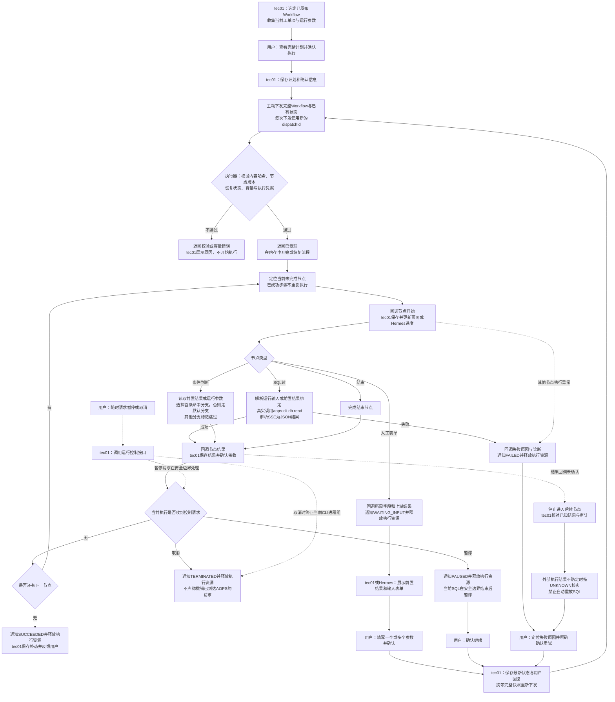

# Workflow执行流程图

适用：itsm-workflow 0.10.1与tec01生产对接。tec01同时承接页面与Hermes消息渠道，负责生产计划、状态、结果、用户交互及持久化；本仓库不包含tec01实现。

## 图中交互约定

- **谁发起**：tec01主动下发完整计划，不由执行器主动拉取计划或每节点轮询tec01状态。
- **下发接口**：`POST /internal/v1/executions/dispatch`。首次、继续、HITL回复、失败重试均走此接口；恢复沿用同`runId`，生成新的`dispatchId`。受理响应不等于执行成功。
- **计划快照**：tec01保存`workflowSnapshot/workflowContentHash/runInputs/nodeStates/nodeOutputs/nodeResults/currentNodeId/selectedRoutes`等已确认信息，恢复时传回。不是只传一个runId让执行器自行找计划。
- **执行凭据**：含SQL读时，每次下发临时提供`X-AOPS-Api-Key`；当前工单ID必填，CLI注释固定为`#uatu-<ticketId>`。凭据不写入Workflow或持久化结果。
- **逐节点通知**：执行器调用tec01的`POST /internal/v1/runs/{runId}/callbacks`。`NODE_STARTED`表示节点开始；`NODE_COMPLETED`包含状态、结果、诊断、人工交互或分支信息；`RUN_RELEASED`表示本次执行已结束或让出资源。
- **确认后再前进**：执行器等待节点结果回调成功后才进入下一节点。tec01应先持久化再返回确认；页面与Hermes从tec01获得进展，而不是依赖Agent一次工具调用一直不返回。
- **暂停/取消**：`POST /internal/v1/executions/{runId}/commands`，type为`PAUSE`或`CANCEL`。接口受理不代表状态已经生效，以后续回调为准；只有活动运行才能接受控制。
- **暂停**：不冻结外部进程。当前SQL安全结束后停止后续步骤并释放内存中的活动执行任务。
- **取消**：终止当前本地CLI进程组，保留已经确认的结果，不保证撤销外部请求。已取消节点不自动重执行。
- **失败/未知**：失败后释放活动任务，明确确认后再重试；服务崩溃或回调丢失可能造成`UNKNOWN`。先核实SQL是否已经执行，再决定保留成功结果还是重执行，禁止自动重放。
- **人工输入**：使用`hitl_form`，不使用已移除的选择节点或LLM运行节点。用户提交后传`resumePayload={"nodeId":"input-1","action":"SUBMIT","values":{...}}`；输出通过`/values/<字段名>`绑定给后续节点。
- **条件与跳过**：按连线顺序选第一条命中的条件，否则走唯一默认边；未选分支独有节点标记`SKIPPED`，共用的后续节点仍可继续。

## 人与数据分别在哪里

用户在tec01页面或Hermes消息中查看计划、节点结果、输入请求和失败原因。tec01负责交互与持久化，执行器只负责当前一次活动执行。等待人工输入、暂停、失败或完成后均不保留常驻执行任务；恢复依靠tec01保存的可信快照。

独立Studio使用相同执行核心，但由浏览器IndexedDB保存计划、状态和结果，后台仍不建数据库；默认不同步tec01。测试单个节点时手工建立最小Workflow，例如“SQL读→结束”，不再提供专用单节点调试接口或节点管理页面。

接口详情：[执行器提供的API](itsm-workflow-to-tec01-api.md)、[tec01回调API](tec01-to-itsm-workflow-api.md)、[JSON约束说明](json-validation-contract.md)。
