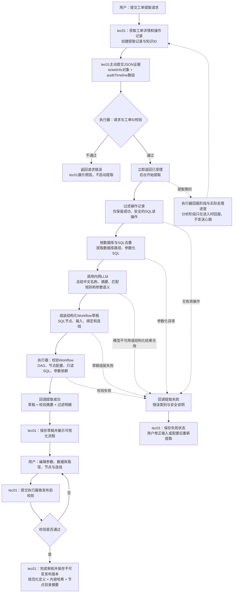

# 草稿提取流程图

适用：itsm-workflow 0.10.1与tec01生产对接。tec01侧的页面、存储、审核和发布为下游需承接的职责；本仓库不包含tec01实现。

## 图中交互约定

- **谁发起**：tec01主动传入工单JSON，不是执行器轮询或拉取tec01任务。
- **输入格式**：`ticketInfo=info.data`对象，`auditTimeline=audit_timeline.data`数组；`ticketId`必须为正整数且与`ticketInfo.id`一致。tec01预先生成`knowledgeId`和`requestId`。
- **提取接口**：`POST /internal/v1/extractions/{knowledgeId}`，202表示受理，不表示成功。
- **回调接口**：执行器调用tec01的`POST /internal/v1/extractions/{knowledgeId}/callbacks`；`PROGRESS`传阶段，`FINISHED`传最终成功或失败。
- **过滤顺序**：仅`sql_exec_read`、result明确成功、details/SQL可解析且为安全单条只读SQL的操作进入候选；按时间整理，参数化阶段再去重。失败、无效及重复操作记录原因。
- **当前自动草稿能力**：提取成功的SQL读步骤，生成线性SQL流程并追加结束节点；不会自动推断业务条件或自动生成完整HITL分支。需要时由用户在审核编辑中补充`condition/hitl_form`及结果绑定。
- **LLM用途**：只辅助草稿分析和通用语义提炼，不执行SQL，也不是运行时节点。模型分析失败不自动生成可发布草稿。
- **重试**：同知识ID、同requestId、同证据的重复提交不重复编译；提取失败后重新分析，使用同知识ID与新的requestId。当前去重记录是有限期进程内缓存，tec01仍需持久化并做幂等控制。
- **回调未确认**：提取结果与同步状态分开处理，不能把回调网络失败直接视为提取失败；终态回调可在缓存仍有效时按原请求重新投递。tec01按幂等键接收，不重复创建草稿。

## 独立Studio调试的区别

使用Studio时，浏览器代替tec01保存本地提取结果和知识，后台仍无业务数据库。默认不回调tec01，页面读取临时事件缓存；开启同步后才发送上述回调。Studio可直接粘贴JSON，也可临时提供`AOPS_API_KEY`，由CLI根据工单ID获取证据。

接口详情：[执行器提供的API](itsm-workflow-to-tec01-api.md)、[tec01回调API](tec01-to-itsm-workflow-api.md)。
