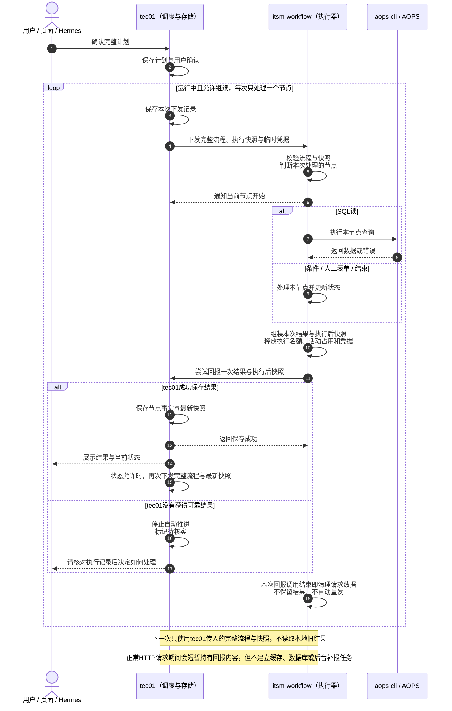
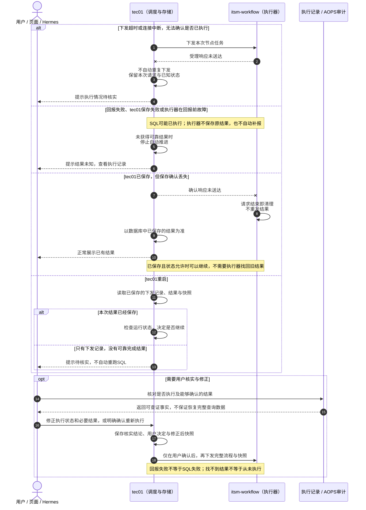
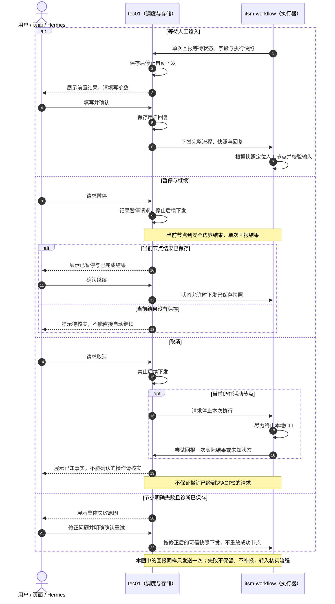

# 执行方案二：单节点执行后释放，不保留本地结果

日期：2026-10-19。

**状态：待评审方案，尚未按此方案修改执行代码。**

> 本文件保留为“逐节点释放、重新下发”的对照方案，不是本轮拟采用的执行方式。当前评审请以[方案一修订版：计划驻留内存、逐节点确认后连续执行](execution-save-then-release.md)为准。

本稿取消上一版的SQLite、本地10分钟结果缓存、自动补报及相关清理机制。

> 一句话说明：tec01下发完整流程和当前快照，执行器判断并处理一个节点，结束实际执行后只尝试回报一次。调用结束即清理本次数据；回报失败不补报、不自动重跑，由tec01用户核对执行记录并修正。

## 一、职责与保存范围

| 负责方 | 负责内容 |
|---|---|
| tec01 | 保存计划、下发记录、收到的节点结果、最新快照、用户确认与人工修正；决定是否再次下发 |
| 执行器 | 仅在本次任务内处理一个节点，尝试回报一次结果与更新后的快照；不保存可供后续查询或重发的结果 |
| 用户 / 页面 / Hermes | 查看进度，填写人工参数，处理暂停取消；异常时根据可查记录核实并决定修正或重试 |

下一次执行只使用tec01传来的完整流程和最新可信快照。执行器不自行进入下一节点，也不依赖本地历史结果。

正在执行的任务仍需内存保存当前上下文；发送回报的HTTP调用也会短暂持有请求内容。**这不属于结果缓存：调用结束或超时后即清理，不保存数据库、不保留到下次调用、不建立后台补报任务。**

## 二、正常执行泳道图

### 正常顺序

1. tec01先保存本次下发记录，再发送完整流程、执行快照和临时凭据。
2. 执行器校验并判断本次应执行的节点，只处理这一个节点。
3. 节点完成后组装结果和执行后快照，释放实际执行名额、活动占用和凭据。
4. 尝试回报一次；tec01只有保存成功后，才按运行状态决定是否再次下发。
5. 回报请求结束后清理本次请求数据，不额外等待一次“已退出”通知。

“保存确认”仅是这一次正常回报调用的响应，不用于触发本地重试或延长结果保留。即使响应丢失，只要tec01实际已经保存，就以tec01数据库中的事实为准。

节点开始通知只用于展示进度，不替代最终结果；未收到开始通知也不能证明SQL没有执行。

## 三、调用失败与用户修正泳道图

### 异常处理规则

执行器回报失败后不再发出补报。因此，结果缺失需要tec01根据下发记录、节点允许执行时长和通信余量进行检查，或由用户主动查看后发现；不能依赖执行器再通知一次“回报失败”，也不能把暂时没有回报立即判定为SQL失败。

| 情况 | 处理 |
|---|---|
| 明确校验失败或容量不足、请求未受理 | 不执行节点，tec01展示原因，修正或等待后可再次提交 |
| 下发超时，是否受理不确定 | 不自动重发执行请求；保留下发记录，由用户核实 |
| 节点结果回报失败 | 执行器结束本次调用，不保存结果、不自动重发；tec01未收到可靠结果时停止推进 |
| tec01保存失败 | 不继续下发，用户按执行记录核实；不能把它当成SQL未执行 |
| tec01已保存但确认丢失 | 已保存结果有效；执行器不重发，tec01按已有事实处理 |
| 执行器在SQL执行中或回报前重启 | 无本地结果恢复，tec01根据下发记录及审计提示待核实，不自动重跑 |
| tec01重启 | 从自己的数据库恢复；结果已保存则按状态继续，结果缺失则待核实 |
| 原回报迟到 | 只核对对应的原执行，不覆盖较新的用户修正、取消状态或后续进度 |
| 节点明确失败且诊断已保存 | 展示诊断，用户修正并明确确认后再重试 |

### 用户核实的依据与限制

- 依据tec01已经保存的下发记录、节点事件、已有结果，以及能够查到的AOPS执行记录或审计进行判断。
- 正常服务诊断日志可以保留必要标识和脱敏错误摘要，但不把完整SQL结果、快照或凭据写入本地日志充当结果存储。
- 执行记录能证明请求发生或SQL执行，不一定能恢复完整查询结果。**结果丢失是本方案明确接受的可靠性边界。**
- 若后续节点依赖已经丢失的输出，不能只把前置节点改成成功就继续；需补充能够确认的结果或由用户明确同意重新查询。
- tec01保存核实结论、操作者决定及修正后的快照，之后再重新下发。执行器仍按流程和快照校验输入，不猜测缺失参数。

## 四、人工输入、暂停、取消与重试泳道图

## 五、必要边界

1. **不自动重试结果回报，也不因回报失败自动重跑SQL。** 回报调用使用正常的请求超时，失败即结束；本稿不定义10分钟结果保留期。
2. **tec01是唯一的流程状态和结果保存方。** 未收到可靠结果时，不能用旧快照中的“未完成”推断SQL从未执行。
3. **重复执行控制由tec01负责。** 同一运行不能并发下发；执行器只对仍在活动中的任务做并发保护，任务结束或服务重启后不承诺能够识别和查询所有历史下发。
4. **不能依靠重复调用执行接口找回结果。** 执行器不提供历史结果补取保障；状态不确定时先核实，用户确认后才作为新的执行下发。
5. **暂停与取消不等于外部回滚。** 暂停阻止后续下发，当前节点到安全边界结束；取消尽力停止当前CLI，不保证撤销已到达AOPS的请求。
6. **凭据只用于当前执行。** AOPS Key不进入流程快照、历史结果或日志，任务结束后不保留。
7. **接受简化的代价。** 网络或服务异常可能丢失尚未保存在tec01的结果，需要用户核实和修正；本方案不承诺自动补齐结果或外部操作严格只执行一次。

---

本文件仅调整方案二的评审设计，未修改执行代码、配置或安装包。后续若实施，应同步取消与本稿冲突的结果持久化、定时缓存和自动回报重试，不改动方案一及草稿提取评审文件。
