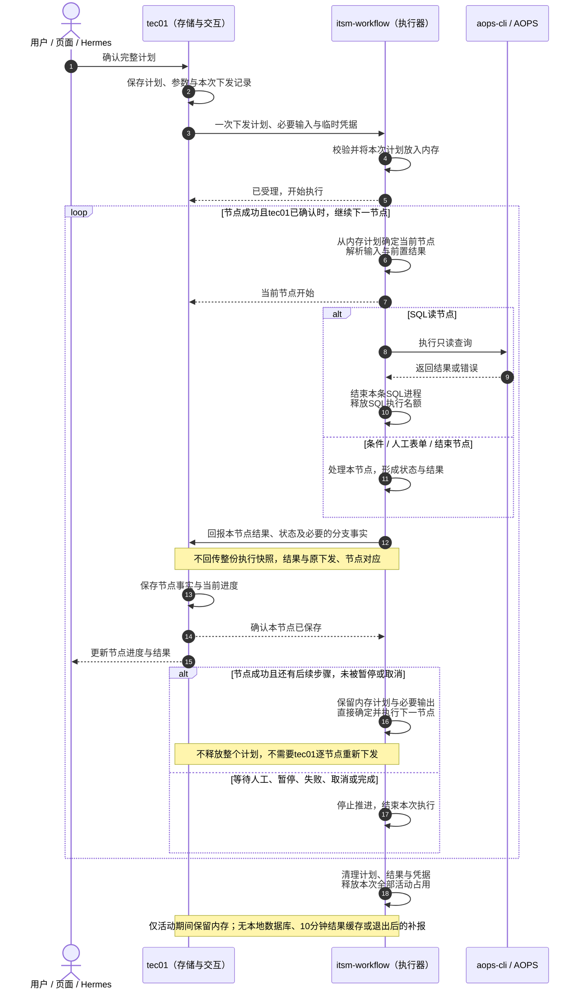
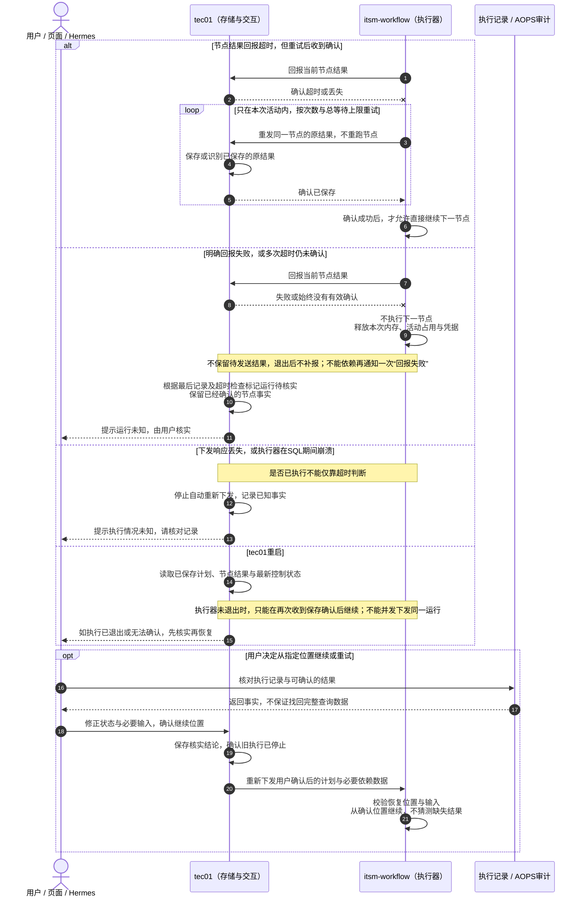
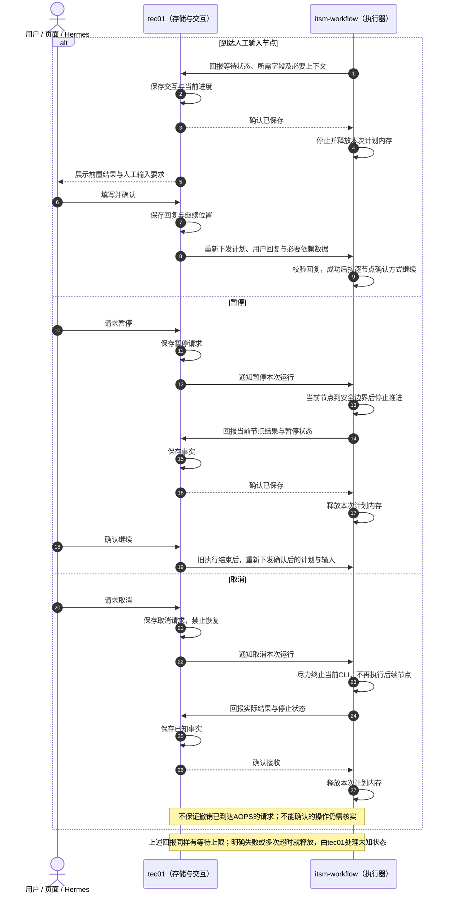

# 执行方案一（修订）：计划驻留内存，逐节点确认后连续执行

日期：2026-10-19。

**状态：执行器侧已按0.11.0对齐主要流程；tec01的保存确认与状态持久化仍需下游配套。** 实现、默认超时与剩余约定见[对齐说明](../runtime-alignment-0.11.0.md)。

本方案更接近之前的方案一，但取消“每个节点确认后释放、由tec01再次下发”的方式：**tec01下发一次计划，执行器放入内存，执行一步、回报一步，收到保存确认后直接执行下一步。**

方案二的“执行一节点就释放、再次下发才能继续”不再是本轮拟采用的方式。本稿同时取消正常执行期间整份快照的往返传递。

## 一、可以这样阐述

> tec01负责保存计划和执行记录；执行器只在本次运行期间把计划和必要结果放在内存中。每个节点结束后，把这个节点的结果回报给tec01，收到保存确认才继续下一步。回报明确失败或多次超时，就停止推进并释放内存；tec01保留已知事实、标记待核实，由用户判断如何从某个位置继续。

| 负责方 | 职责 |
|---|---|
| tec01 | 保存计划、用户确认、节点结果、执行进度和控制状态；处理用户核实与恢复 |
| 执行器 | 在内存中按计划执行节点、处理条件与结果绑定；逐节点回报并等待确认 |
| 用户 / 页面 / Hermes | 查看进度，填写参数，暂停取消；异常后核实记录并确认继续或重试 |

执行器无本地业务数据库，也不在本次活动退出后保留结果缓存或补报任务。

## 二、正常执行泳道图

### 哪些资源每步释放，哪些不能释放

- 每条SQL执行完，SQL子进程及对应SQL并发名额可以释放。
- **整份内存计划、本次运行的活动占用、后续绑定需要的输出及执行凭据不能每步清掉**，否则无法直接执行后续SQL。
- 等待人工、暂停、明确失败、取消、完成，或回报失败达到停止条件后，结束本次活动，清理计划、结果和凭据。
- 活动期间的内存不是供以后查询的历史结果库；活动结束后不承诺找回未送达结果。

### 回报什么，不回报什么

回报本节点标识、状态、结构化结果，以及条件节点已经选中的分支/跳过节点、人工输入要求或具体错误等实际执行事实。tec01依据这些记录展示并保存进度。

节点回报也应表达本次运行已经完成、等待输入或停止等实际结论，不能让tec01仅因收到一个成功节点就假定整份计划完成。这里不要求传完整内存快照，也不是让tec01重新判断执行路线。

**不逐节点回传整份执行快照，也不返回“下一步建议”。** 执行器收到本节点保存确认后，自己根据内存计划决定并执行下一节点；tec01不参与每一步的重新下发。

条件判断、参数绑定和新增节点逻辑仍由执行器负责。正常回报的确认只表示原节点事实已可靠保存，不是用户对每条SQL重新审批；用户仍在执行前确认完整计划。

## 三、回报失败与用户恢复泳道图

### 回报等待规则

- 本节点结果未得到保存确认，绝不执行下一节点。
- 明确失败响应时停止本次运行；超时可在本次活动内有限重发**同一次结果**，不重新执行节点。
- 重试次数和总等待时长必须有上限，具体数值待实现时配置；超过上限就清理内存，不继续等待。
- 这不属于退出后的补报机制：活动仍在时可有限等待确认，活动退出后没有结果缓存、恢复投递或数据库重发。
- 同一结果重发时，tec01应保存一次并返回一致确认，不重复更新、不覆盖较新的用户修正。
- 节点明确执行失败时，即使失败结果保存确认成功，也停止后续执行，等待用户处理。

### tec01怎样处理“未知”

tec01不能依赖执行器一定能再通知一次“回报失败”：网络不通或进程已崩溃时该通知同样可能丢失。应根据已保存的下发记录、最后节点事件、允许执行时长和通信余量，发现中断并提示待核实。

**运行标记未知，不代表把所有已成功节点也改成未知。** 已经保存的节点结果仍是事实；只对没有可靠结论的执行位置进行核实。即使tec01已保存当前结果，确认丢失也可能使执行器退出，不能仅凭一次保存就认定后续仍在运行。

用户依据tec01记录及AOPS审计，确认哪些步骤已执行、哪些结果可用，再决定从哪里继续。审计不一定能恢复完整查询数据；未保存结果丢失是本方案接受的边界，不能靠自动重跑SQL掩盖。

## 四、人工输入、暂停与取消泳道图

- 等待人工输入时先保存表单和进度，执行器结束本次活动，不让内存任务无限等待用户。
- 暂停必须由tec01通知当前执行器。**仅停止tec01下发没有作用**，因为执行器已经持有整份计划，会自动推进。
- 暂停在节点安全边界生效；取消尽力终止当前本地CLI，但不保证撤销外部已收到的请求。
- 如控制请求或状态回报未确认，tec01展示请求中或待核实，不能直接宣称已经暂停/取消。
- 用户继续前，先确认旧活动已停止，避免旧执行与新计划并发运行。

## 五、重新下发需要带什么

首次下发提供完整计划、当前工单ID、运行参数和临时AOPS凭据；执行器校验后放入内存并连续推进。

人工输入、暂停恢复或异常处理后，需要再次下发**用户确认或修正后的计划**，包括：

- 本次确认的继续位置，以及不能再重复执行的已完成步骤信息。
- 本次实际需要的运行参数或用户回复。
- 后续节点绑定所需的已确认前置结果，或者已转换成明确运行输入的对应值。
- 当前有效的临时AOPS凭据。

这不是在正常执行期间反复传整份执行快照，也不要求把与后续执行无关的全部历史结果再次传给执行器。

**只传“从第几步开始”并不总是足够。** 如果后续SQL仍依赖先前查询结果，而该值未传入，执行器必须拒绝或要求补齐，不能从已经释放的内存中查找，也不能猜测。具体数据字段在评审确认后再定义。

## 六、异常处理摘要

| 情况 | 处理 |
|---|---|
| 校验失败或容量不足，明确未受理 | 不开始执行，tec01展示原因，修正或等待后再提交 |
| 下发响应丢失，是否已执行不明 | 不盲目重复下发，先核实当前活动及执行记录 |
| 回报超时，有限重试后确认成功 | 重试的是原结果，不是SQL；确认后继续内存计划 |
| 明确回报失败或超时超过上限 | 不执行下一节点，清理本次内存与凭据；tec01处理未知状态 |
| SQL已执行但结果未保存即崩溃 | 无本地恢复，用户核对记录并明确决定如何继续 |
| tec01重启 | 读取已保存记录，不与旧活动并发下发；无法确认运行是否继续时先核实 |
| HITL输入不合法 | 不执行后续SQL，要求用户修正，按确认后的计划再次提交 |
| 节点失败且诊断已保存 | 停止，用户修正并明确确认后重新下发 |
| 所有节点完成 | 保存完成事实后清理本次内存；最终通知丢失时以已确认记录核实 |

## 七、与此前方案的区别

| 问题 | 本次修订方案一 |
|---|---|
| 正常情况下tec01每节点重新下发吗 | 不需要，执行器收到确认后直接推进 |
| 每节点释放整份计划吗 | 不释放，只释放已经结束的SQL进程等局部资源 |
| 每节点传完整执行快照吗 | 不传，回报对应节点的执行事实 |
| 数据库或10分钟结果缓存 | 不需要，活动退出后清理，不后台补报 |
| 回报是否重试 | 明确失败停止；超时在本次活动内有限重发同一结果 |
| 暂停、HITL、失败、取消或完成 | 停止活动并释放；需要继续时由tec01重新下发确认后的计划和必要输入 |
| 状态未知时谁处理 | tec01展示事实，用户核实与修正后确认恢复 |

---

本稿为当前方案一的设计说明，执行器侧0.11.0已完成对应对齐；不能据此宣称tec01端已实现全部职责。方案二保留为对照稿，剩余边界与待确认事项见对齐说明。
