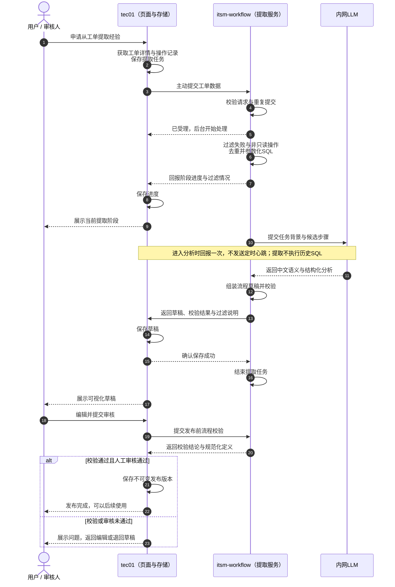
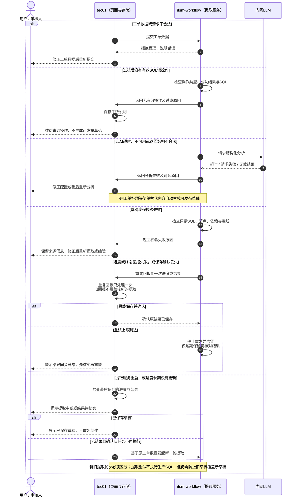

# 草稿提取方案：含异常处理

日期：2026-10-19。

**状态：提取主线基于0.10.1；异常恢复包含tec01侧需配套实现的职责，不代表本仓库已实现tec01功能。**

tec01主动提交工单数据并保存进度和草稿；提取服务过滤操作、调用内网LLM并生成结构化流程，人工修正审核后再发布。

## 1. 草稿提取与审核发布

## 2. 输入、模型、校验、回报与中断异常

## 异常处理说明

| 情况 | 处理方式 |
|---|---|
| 工单数据不合法 | 拒绝受理，提示修正；工单详情传data对象，操作记录传data数组 |
| 工单ID不一致或重复请求冲突 | 拒绝错误请求，不重复分析 |
| 过滤后无有效SQL | 返回过滤原因，不生成可发布草稿 |
| LLM超时、不可用或返回结构不合法 | 返回明确分析失败，修正配置或稍后重新分析 |
| 草稿组装或流程校验失败 | 返回可读原因，保留来源信息供修正，不自动发布 |
| 进度或结果回报失败 | 重试回报同一次内容，不重复创建草稿 |
| tec01已保存但确认丢失 | 重复回报只处理一次，并再次确认已保存结果 |
| 回报重试上限到达 | 告警并提示同步异常，不直接把同步失败当作分析失败 |
| 提取服务重启或长时间未收到终态 | 核对最后保存的进度、结果及旧任务状态，提示中断或结果待核实；不能按15秒无心跳判失败 |
| 已保存草稿但页面未更新 | 展示tec01已保存的草稿，不重复创建 |
| 无草稿且确认旧任务不再执行 | 基于原工单数据发起新一轮提取，区分新旧轮次 |
| 旧提取轮次回报晚到 | 不得覆盖新一轮的进度、草稿或审核状态 |
| 人工审核或发布前校验未通过 | 返回编辑或退回草稿，不能直接发布 |

## 提取边界

- 仅从明确成功的安全单条SQL读操作形成候选；失败、无效、非读和重复操作记录过滤原因。
- LLM只参与草稿语义提炼，不是运行时节点，不执行历史SQL。
- 无有效操作、模型失败或校验失败时，不以工单标题等简单替代内容生成可发布草稿。
- 自动草稿以SQL读流程为主，条件、人工表单及结果绑定仍需人工核对或补充。
- 提取重做不执行生产SQL，但仍需区分任务轮次，防止旧回报覆盖新草稿。
- 提取服务的内存缓存不是持久化保障；生产进度、草稿、审核和版本由tec01保存。
- Studio可用浏览器存储独立调试，但不能替代生产持久化。

---

本文件为技术评审材料，不涉及本轮执行代码修改。泳道图使用Mermaid，可在支持Mermaid的Markdown工具中查看或编辑。
