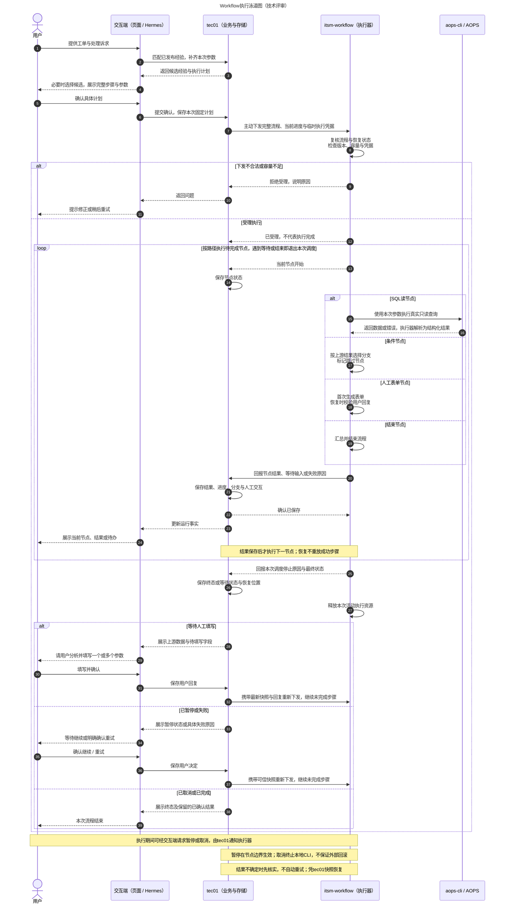

# 流程执行泳道图｜技术评审版

评审基线：itsm-workflow 0.10.1；整理日期：2026-10-19。

## 方案概述

tec01是生产计划与状态的唯一持久化方，也是页面和Hermes消息渠道的业务入口；itsm-workflow接收完整流程与恢复快照，在内存中执行并逐节点回报。**不是执行器主动拉计划，也不是tec01每执行一个节点都再下发一次指令。** 正常情况下由执行器连续推进；等待人工、暂停、失败或结束后释放活动任务，需要继续时由tec01重新下发。

本图描述两端协作方案：执行侧能力在本项目实现；tec01侧的权限、确认、数据存储与消息推送需要下游配套实现。

## 泳道图

图中的“按路径执行”会在等待输入、暂停、失败、取消或完成时停止，不会继续执行后续节点。恢复箭头表示重新进入相同的校验和执行阶段，不是恢复一个长期挂起的进程。

## 评审要点

### 计划与状态分别由谁持有

- tec01保存固定版本、工单、运行参数、用户确认、节点状态、已确认输出、选中分支和人工回复。
- 执行器只持有当前一次活动执行的完整上下文；节点结果先由tec01保存并确认，再继续下一节点。
- 页面展示与Hermes回答以tec01保存的运行事实为依据，不以Agent一次工具调用的自然语言回复作为执行事实。

### 人在回路怎样闭环

SQL结果可能为空、一行或多行，由条件节点读取行数或其他字段决定路径。需要人判断时进入人工表单，用户参考结果填写一个或多个参数。tec01保存回复后重新下发，人工表单输出绑定给后续SQL节点。当前不使用LLM运行节点，也不使用人工选择节点。

### 暂停、取消、重试怎样区分

| 情况 | 执行器行为 | tec01与用户行为 |
|---|---|---|
| 暂停请求 | 当前节点到安全边界后停止后续步骤，回报已暂停并释放资源 | 区分“暂停请求中”和“已暂停”；用户确认继续后重发快照 |
| 等待人工输入 | 回报字段与上下文，释放活动任务 | 展示表单，保存用户回复，再重发快照 |
| 执行失败 | 回报脱敏诊断，停止后续节点并释放资源 | 用户定位问题并明确确认后重试；已成功步骤不重放 |
| 取消请求 | 尽力终止当前本地CLI进程组，回报实际状态并释放资源 | 保留已经确认的结果，不宣称外部请求已撤销 |
| 结果未知 / 服务中断 | 不能保证外部调用是否完成，不自动重放 | 依据最后确认结果及AOPS审计核实后，再决定继续或重执行 |
| 正常完成 | 回报完成并释放资源 | 保存终态，展示完整结果 |

控制请求由“用户→交互端→tec01→执行器”传递；命令受理不等于已经生效。暂停不冻结外部进程，取消也不是数据库回滚。

### 如何支持后续节点扩展

执行器通过统一Node Registry维护节点类型、配置约束、输入输出与版本，调度核心处理顺序、分支、绑定和状态回报。当前支持SQL读、条件、人工表单与结束；新增操作类型需在执行器实现并发布，tec01获取新目录与约束后再开放编排，不能把任意脚本写入流程直接执行。

### 需在评审中确认的边界

1. **没有承诺外部操作严格只执行一次。** 重复下发与回报做幂等控制，但SQL已发出、回报未确认时仍可能未知，必须人工核实。
2. **回报链路是生产前进条件。** tec01不可用时不能继续无界执行；两端须明确超时、失败告警与恢复操作。
3. **凭据只用于本次执行。** 实际SQL必须有当前用户AOPS Key及工单ID，凭据不写入Workflow或结果；每次重新下发应提供有效凭据。
4. **状态展示需要交互端配合。** 页面订阅tec01状态更新；Hermes由tec01的MCP查询及渠道通知获得事实，不会仅凭MCP连接自动渲染完整画布或自动持续刷新。
5. **浏览器调试不等于生产持久化。** Studio用浏览器本地存储保存计划与结果，后台不建数据库；生产恢复必须依赖tec01的可靠存储与可信快照。

## 交付附件

- [泳道图SVG](review-diagrams/execution-swimlane.svg)：适合放大查看、插入评审材料。
- [泳道图PNG](review-diagrams/execution-swimlane.png)：适合直接粘贴到评审文档。
- [Mermaid图源](review-diagrams/execution-swimlane.mmd)：可继续编辑。
