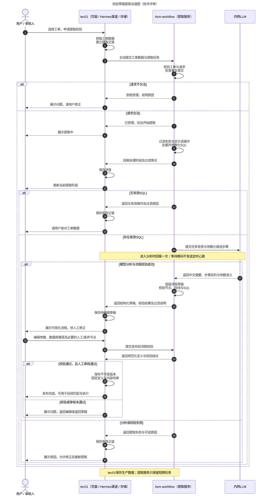

# 草稿提取泳道图｜技术评审版

评审基线：itsm-workflow 0.10.1；整理日期：2026-10-19。

## 方案概述

tec01负责工单数据准备、提取记录、用户交互、草稿管理、审核与版本保存；itsm-workflow负责筛选操作、参数化、调用内网LLM和生成可校验的流程定义。**tec01主动提交工单数据，提取服务主动回报进度，不采用轮询领取任务。**

本图描述两端协作方案：执行侧能力在本项目实现；tec01的持久化、页面、Hermes渠道及审核发布需要下游配套实现，不表示本仓库已经包含tec01功能。

## 泳道图

## 评审要点

1. **程序控制可信边界。** 只从明确成功的安全SQL读操作形成候选，过滤失败、无效和重复操作；具体历史条件值改为参数，保留可核对的过滤说明。
2. **LLM辅助提炼，不负责执行。** 模型总结中文名称、摘要、用途及参数语义，程序组装并校验草稿；没有有效SQL或分析失败时，不生成可直接发布的经验。生产取证数据与模型输入仍需遵循内网数据权限和脱敏要求，不应假定所有自然语言都已完全匿名。
3. **自动草稿不是自动批准。** 当前自动提取以线性SQL读流程为主；条件分支、人工参数输入和跨节点结果绑定需要人工确认或补充，发布前重新校验。
4. **状态与内容在tec01。** tec01保存进度、失败、草稿、修改和发布版本；提取服务不建立第二套生产知识数据库。分析阶段不发送定时心跳，不能把“已受理”当作“已完成”，也不能把没有新进度直接判为失败。
5. **传输失败与提取失败分开。** 回报可重试且需幂等；回报未确认不能直接推断提取失败。进程缓存不是持久化保障，故障后由tec01核对任务再决定重投。
6. **发布后才进入使用链路。** 审核通过后，tec01固定规范化定义、版本与内容哈希；后续编辑不能悄悄修改已被计划引用的版本。

## 与独立调试的区别

Studio调试时，由浏览器本地存储代替tec01保存草稿。可直接粘贴工单数据，也可临时提供AOPS Key按工单ID取证；默认不向tec01同步。两种入口复用相同提取与校验逻辑。

## 交付附件

当前行为以本文Mermaid和图源为准；下列SVG/PNG为历史评审静态附件，未随本次取消分析心跳重新渲染，不应作为当前回报协议依据。

- [泳道图SVG](review-diagrams/extraction-swimlane.svg)：适合放大查看、插入评审材料。
- [泳道图PNG](review-diagrams/extraction-swimlane.png)：适合直接粘贴到评审文档。
- [Mermaid图源](review-diagrams/extraction-swimlane.mmd)：可继续编辑。
