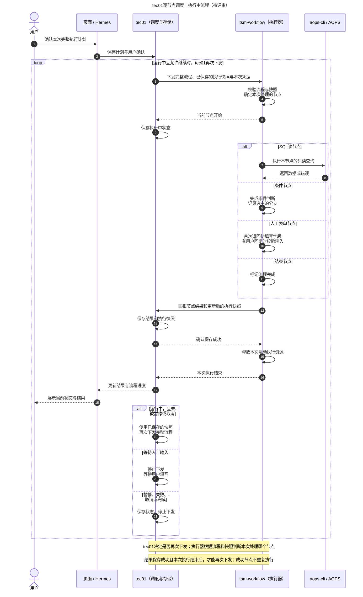
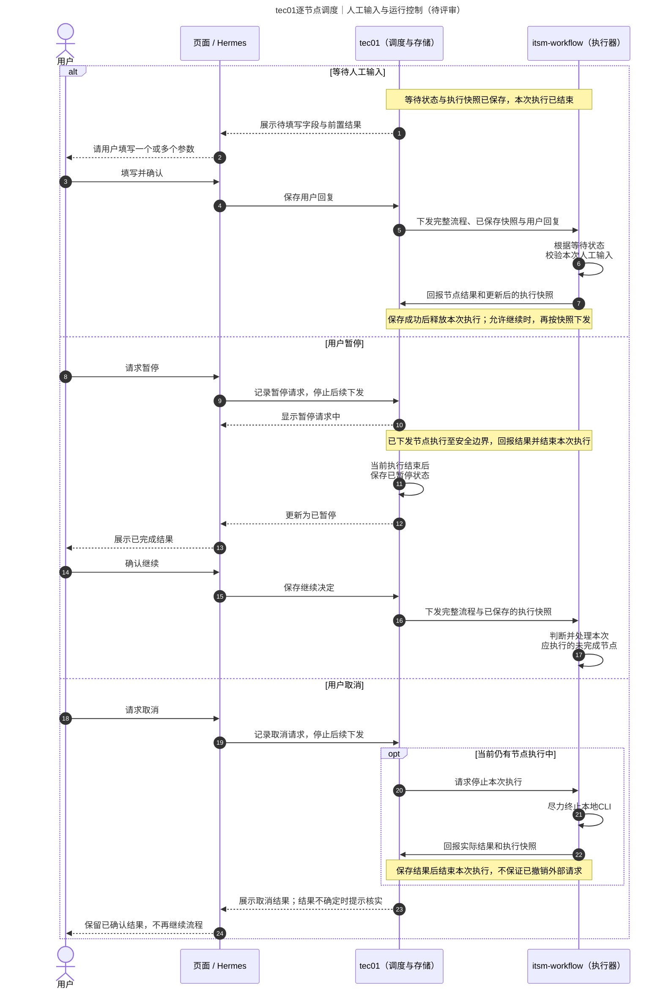

# tec01逐节点调度方案｜泳道图评审稿

**状态：待评审，尚未按此方案修改执行代码。** 日期：2026-10-19。

## 一、方案说明

**tec01每次下发完整流程和已保存的执行快照，执行器根据这些信息判断并处理一个节点。**

执行器回报节点结果和更新后的执行快照。tec01保存成功后，执行器释放本次活动任务；本次执行结束后，tec01根据运行状态决定是否再次下发。

tec01不计算下一个节点，也不重新实现条件判断和参数绑定。具体应该执行哪个节点，始终由执行器根据完整流程与快照判断。

| 负责方 | 职责 |
|---|---|
| 用户 / 页面 / Hermes | 查看并确认计划、填写人工参数、请求暂停或取消 |
| tec01 | 保存计划、节点结果和执行快照，决定是否再次下发 |
| itsm-workflow | 根据流程和快照处理一个节点，回报结果和更新后的快照，释放本次活动资源 |
| aops-cli / AOPS | 执行真实SQL读并返回数据 |

草稿提取、经验匹配、审核发布和完整计划确认方式不变。本稿只调整流程执行方式。

## 二、执行主流程泳道图

- [主流程PNG](review-diagrams/execution-step-dispatch.png)
- [主流程SVG](review-diagrams/execution-step-dispatch.svg)
- [可编辑图源](review-diagrams/execution-step-dispatch.mmd)

## 三、人工输入、暂停和取消泳道图

- [人工输入与控制PNG](review-diagrams/execution-step-controls.png)
- [人工输入与控制SVG](review-diagrams/execution-step-controls.svg)
- [可编辑图源](review-diagrams/execution-step-controls.mmd)

## 四、执行快照保存什么

快照表示“这个流程已经执行到哪里”，至少包含节点状态、已完成输出、已确定的分支和当前执行位置。

- SQL节点：保存查询结果与成功或失败状态。
- 条件节点：保存已选分支及跳过节点，恢复时不重新改变已经确定的路径。
- 人工表单节点：未收到回复时保存等待状态和待填写字段；收到回复后，由执行器校验并产生后续可用的参数。
- 结束节点：标明流程已完成，tec01不再下发。

这些都是节点结果和执行快照的一部分，不另行增加一套业务指令。tec01保存执行器返回的快照，下次携带完整流程一并传回；不自行修改节点执行位置或重新计算分支。用户回复作为本次恢复输入传入。

## 五、什么时候再次下发

| 当前情况 | tec01如何处理 |
|---|---|
| 节点成功，流程仍在运行 | 保存结果，等待本次执行结束，再下发完整流程与最新快照 |
| 等待人工输入 | 停止下发；收到并保存用户回复后，携带快照与回复再次下发 |
| 暂停 | 停止后续下发；当前节点安全结束后保存已暂停状态，用户确认继续后再下发 |
| 明确失败 | 展示原因，用户修正并确认重试后，再按已保存快照下发 |
| 取消或完成 | 停止下发，保留已确认的结果 |
| SQL结果不确定 | 先核对审计和已保存结果，不自动重试 |
| 容量不足而未受理 | 等待资源后重试，不当作SQL执行失败 |

## 六、必要边界

1. **先保存，再继续。** tec01保存失败时，执行器重试回报同一次结果，不进入后续节点。保存成功且本次执行结束后，才允许再次下发。
2. **同一流程不能并发推进。** 重复下发、重复回报或较旧的结果，不能造成重复执行或覆盖较新的状态。
3. **释放不等于删除结果。** 结果保存在tec01；执行器仅释放本次活动资源，短期防重复和回报记录可保留。
4. **取消不是回滚。** 终止本地CLI不保证撤销已到达AOPS的请求；结果不确定时必须核实。
5. **恢复不重放成功节点。** 条件判断、参数绑定和新增节点逻辑仍由执行器负责，tec01只保存并传回快照。
6. **凭据不放入快照。** AOPS Key仅用于本次执行，不写入流程定义或历史结果。

本稿仅用于方案评审，不新增单节点调试页面，不改变浏览器本地调试的数据保存方式。具体接口与代码在评审确认后再调整。
