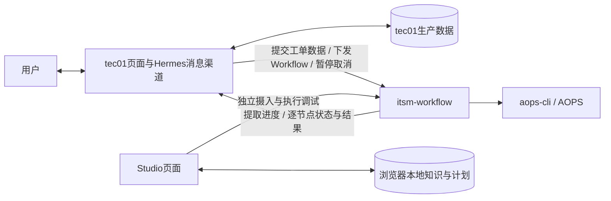
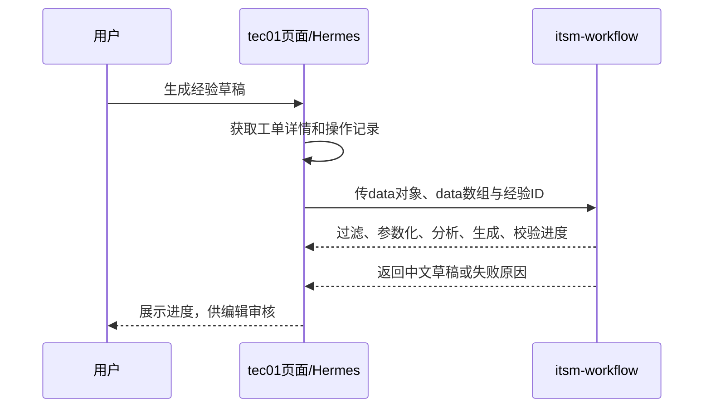
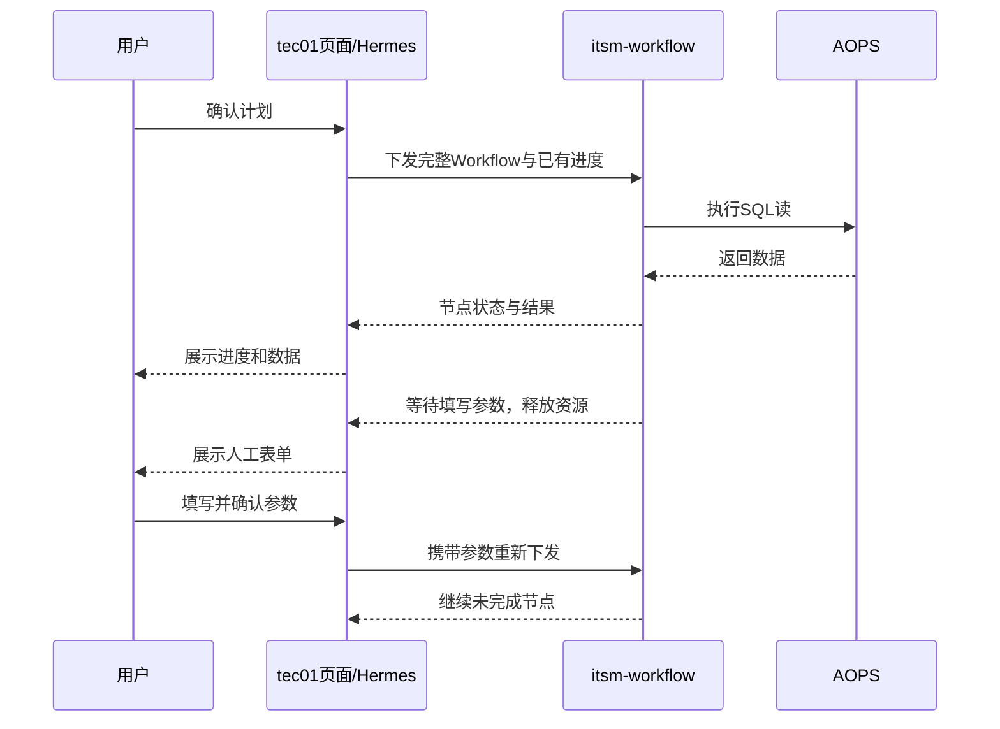

# tec01与itsm-workflow拆分设计

0.11.0已按内存连续执行对齐，运行回调保存确认与恢复前活动查询见[实现对齐及待补充约定](runtime-alignment-0.11.0.md)；不是逐节点释放并重新下发。

## 分工

- tec01：生产知识与版本、用户权限、执行计划、全部运行状态和结果、Web页面、MCP、Hermes消息渠道。
- itsm-workflow：Node Registry、JSON Schema、草稿提取、Workflow校验、逐节点真实执行、暂停和取消。
- Studio浏览器：独立调试知识、手工编辑、多条计划和结果的本地保存。

后台无业务数据库。生产数据由tec01持久化；Studio数据由浏览器IndexedDB持久化，服务端内存只保留活动任务与有限期事件缓存。

## 计划创建与校验

| 时机 | 负责方 | 处理 |
|---|---|---|
| 草稿编辑 | 页面/tec01与itsm-workflow | 获取JSON Schema生成表单，调用Workflow校验纠错 |
| 发布 | itsm-workflow校验，tec01保存 | 校验只读SQL、节点配置、条件、绑定和DAG；保存规范化不可变版本与内容哈希 |
| 创建计划 | tec01 | 检查权限、工单ID、当前运行输入，保存完整版本快照和planHash |
| 用户确认 | tec01页面/Hermes | 展示完整计划，确认同一planHash |
| 下发执行 | itsm-workflow | 校验快照哈希、节点版本与配置，按已有状态执行 |

计划创建无需每次重新请求整张DAG校验。tec01可用发布时的版本与已缓存Schema检查运行输入；上游SQL结果和HITL参数只有运行到相应步骤时才存在。

`workflowContentHash`用于核对定义，`planHash`用于核对本次向用户展示的版本、工单ID、参数和执行内容。正式计划与用户确认始终保存在tec01。

## 草稿提取

Compiler只采纳 `operation=sql_exec_read`、结果明确成功、数据库路径完整且安全单语句的SQL，去除重复操作；实际条件值改为参数。LLM只参与中文名称、摘要、步骤目的与参数语义提炼，不能在运行时替用户填写值。

五个阶段各在进入时上报一次，不发送逐项进度或定时心跳；阶段与终态共用递增seq。成功返回草稿、校验摘要及包含重复过滤项的完整账本。

## 生产执行与恢复

tec01主动下发完整Workflow、工单ID、当前运行参数、节点状态、已完成输出和分支信息。Executor立即确认受理，后台逐节点执行。每个节点开始和完成都返回tec01；开启生产回调时，结果未被确认不得执行下一节点。

已完成或已跳过节点不会重放。tec01每次开始、恢复或重试生成新dispatchId；同ID同内容重发返回原受理结果，同ID不同内容拒绝。仍在执行的runId不能接受另一份并发调度。

## 条件与人在回路

当前运行节点为 `sql_read`、`condition`、`hitl_form`、`end`。

典型流程：SQL读返回数据后，以 `/nodes/sql-1/output/rowCount > 0` 判断是否进入人工表单。用户根据结果填写一个或多个字段，例如客户编号、状态和返回条数；Executor校验类型与范围，输出 `values`，下游通过 `/values/customer_id` 绑定参数。无数据时进入默认结束分支。

HITL可从tec01页面或Hermes处理。tec01先保存相同交互及用户回复，再重新下发，两个入口共享同一运行事实。Hermes展示字段说明、收集参数并请用户确认，不能猜测答案。

## 暂停、取消和失败

- 暂停：tec01先显示请求中；Executor完成当前SQL后在安全边界回报PAUSED并释放资源。
- 继续：tec01提供完整快照与已提交节点状态，生成新dispatchId重新下发。
- 取消：停止本地CLI并回报结果；如外部执行无法确认，保留UNKNOWN供用户核实。
- 失败：返回具体脱敏诊断并释放资源，用户决定是否重试。
- 等待输入与完成：回报tec01后释放资源。

释放只清除Executor活动上下文，不删除tec01运行记录。服务中断时如SQL已发出且没有完成记录，不能自动认定成功或重放；应由tec01展示结果未知并让用户核实。

## 独立Studio

Studio提供管理Token登录、知识抽取、手工新建、画布编辑、计划确认和流程测试。测试一条SQL时建立“SQL读→结束”的最小流程，使用相同的计划与执行入口。页面采用统一的知识列表和执行中心布局；数据保存在浏览器，可编辑、导入、导出及保存多条记录。

默认不访问tec01；勾选同步后，使用已有tec01知识/运行ID回调。取消从浏览器移除该计划。当前API Key只在执行时临时填写，不保存到IndexedDB、导出包或事件中。

## 接入最小范围

tec01获取Catalog与JSON Schema、发布前校验、提交草稿、下发Workflow、暂停/取消，并提供统一提取/运行回调。三方可按Catalog与JSON Schema构造最小Workflow，并复用同一校验、下发与回调接口。

第一版单服务最大运行数与CLI进程数通过配置限制，容量满返回429；不需要额外消息队列、任务领取进程或第二套状态数据库。
